<div align="center">

<p align="center">
  
</p>

<a href="https://github.com/Abdellah-mouida">
  
</a>

<br/>

<a href="https://github.com/Ihyaa-Program"></a>
<a href="https://ihya-iacsas.vercel.app"></a>
<a href="https://github.com/Abdellah-mouida?tab=followers"></a>


</div>



<div align="center">

```text
 █████╗ ██████╗ ██████╗ ███████╗██╗     ██╗      █████╗ ██╗  ██╗
██╔══██╗██╔══██╗██╔══██╗██╔════╝██║     ██║     ██╔══██╗██║  ██║
███████║██████╔╝██║  ██║█████╗  ██║     ██║     ███████║███████║
██╔══██║██╔══██╗██║  ██║██╔══╝  ██║     ██║     ██╔══██║██╔══██║
██║  ██║██████╔╝██████╔╝███████╗███████╗███████╗██║  ██║██║  ██║
╚═╝  ╚═╝╚═════╝ ╚═════╝ ╚══════╝╚══════╝╚══════╝╚═╝  ╚═╝╚═╝  ╚═╝
```

</div>


## ◈ whoami

```text
┌──(abdellah@zeroox)-[~]
└─$ whoami
abdellah-mouida

┌──(abdellah@zeroox)-[~]
└─$ cat about.txt
name       : Abdellah Mouida
role       : full-stack developer, independent
builds     : bilingual (Arabic / English, RTL + LTR) web platforms
leans on   : Next.js · React · TypeScript · Prisma · three.js
mindset    : offensive security. break it, understand it, build it better
org        : @Ihyaa-Program (Ihyaa Ltd), joined 22 Oct 2026
shipping   : Ihyaa Community Platform · ZEROOX portfolio
last year  : 637 contributions (snapshot, Nov 2026)

┌──(abdellah@zeroox)-[~]
└─$ _
```


## ◈ now building

### 🔷 Ihyaa Community Platform

The official web platform for **Ihyaa Program** (برنامج إحياء), a Moroccan non-profit youth community initiative focused on personal development, education and community service. Live at **[ihya-iacsas.vercel.app](https://ihya-iacsas.vercel.app)**, with 177 commits and counting.

- **Bilingual by design**: full Arabic / English support with RTL + LTR layout adaptation
- **Identity & security**: Auth.js v5 (credentials with email OTP, plus Google OAuth), bcrypt hashing, rate-limited sign-in, cross-device session revocation
- **Events engine**: one-click booking, open vs. limited capacity, numbered waitlists, admin approval and automatic waitlist promotion by email
- **Admin portal**: role-based access (`ADMIN` / `MODERATOR` / `USER`), user directory, and an immutable audit log
- **Craft**: interactive 3D hero scene in three.js, glassmorphic toasts, Playwright end-to-end tests

```text
┌──────────────┐   ┌──────────────┐   ┌──────────────┐   ┌──────────────┐
│  Next.js 16  │──▶│  Auth.js v5  │──▶│    Prisma    │──▶│  Cloudinary  │
│   React 19   │   │  RBAC · OTP  │   │  PostgreSQL  │   │    Brevo     │
└──────────────┘   └──────────────┘   └──────────────┘   └──────────────┘
```

### 🔷 ZEROOX

A cinematic 3D portfolio for my independent developer and offensive-security identity. **AMOLED black, one electric-blue accent, glass as the signature material.** Custom GLSL shaders (aurora, light trails, particles), GSAP + ScrollTrigger scrolling with Lenis, and a custom Tailwind token layer with no default palette. Currently in active construction.


## ◈ stack

<div align="center">


<br/>


</div>

| Layer | What I reach for |
|:--|:--|
| **Frontend** | Next.js (App Router), React 18/19, TypeScript, Tailwind CSS v4, Radix UI, Vite |
| **3D & motion** | three.js, React Three Fiber, drei, postprocessing, custom GLSL, GSAP, Lenis, Framer Motion |
| **Backend & data** | Next.js server actions, Prisma ORM, PostgreSQL (Neon), Node.js |
| **Auth & services** | Auth.js v5, Google OAuth, Cloudinary, Brevo transactional email |
| **Quality** | Playwright E2E, strict TypeScript, ESLint, i18n parity checks |
| **Workflow** | Agent-assisted development (Claude Code, OpenCode), Vercel deploys |


## ◈ repositories

| | Repository | What it is | Built with |
|:-:|:--|:--|:--|
| 🔷 | [**Ihya-iacsas**](https://github.com/Abdellah-mouida/Ihya-iacsas) | Community platform for Ihyaa Program: events, bookings, RBAC admin portal | TypeScript · Next.js · Prisma |
| 🔷 | [**zx**](https://github.com/Abdellah-mouida/zx) | ZEROOX, a cinematic 3D portfolio (in progress) | TypeScript · React · three.js · GLSL |
| 🔹 | [abdellah-mouida-portfolio](https://github.com/Abdellah-mouida/abdellah-mouida-portfolio) | Personal portfolio | CSS |
| 🔹 | [Hiworld-v1-client](https://github.com/Abdellah-mouida/Hiworld-v1-client) | Social platform front end where you post and review others' posts | CSS |
| 🔹 | [Hiworld-v1-server](https://github.com/Abdellah-mouida/Hiworld-v1-server) | Back end for Hiworld | JavaScript |
| 🔹 | [Mayza](https://github.com/Abdellah-mouida/Mayza) | Styling experiments | CSS |
| 🔹 | [NewPipe](https://github.com/Abdellah-mouida/NewPipe) | Fork of [TeamNewPipe/NewPipe](https://github.com/TeamNewPipe/NewPipe), a libre lightweight streaming front end for Android | Java |

<sub>23 public repositories in total. The table lists the ones I keep pinned.</sub>


## ◈ the loop

```text
  ┌──────────┐      ┌───────────────┐      ┌──────────────┐
  │ BREAK IT │ ───▶ │ UNDERSTAND IT │ ───▶ │ BUILD BETTER │
  └─────▲────┘      └───────────────┘      └──────┬───────┘
        │                                         │
        └──────────────── repeat ─────────────────┘
```

Everything I ship goes through the same cycle: **break it** to see where it fails, **understand it** until the failure makes sense, then **build it better**.


## ◈ telemetry

<div align="center">


<br/><br/>


<br/><br/>


<br/>


</div>


## ◈ transmit

<div align="center">

<a href="https://github.com/Abdellah-mouida"></a>
<a href="https://github.com/Ihyaa-Program"></a>
<a href="https://ihya-iacsas.vercel.app"></a>
<!-- Add your own links here, in the same style, for example:
<a href="https://www.linkedin.com/in/YOUR-HANDLE"></a>
<a href="mailto:you@example.com"></a>
-->

</div>


