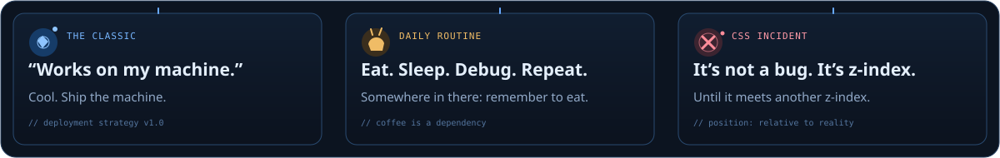
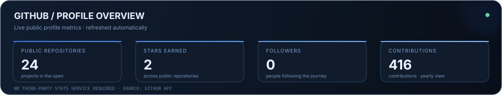
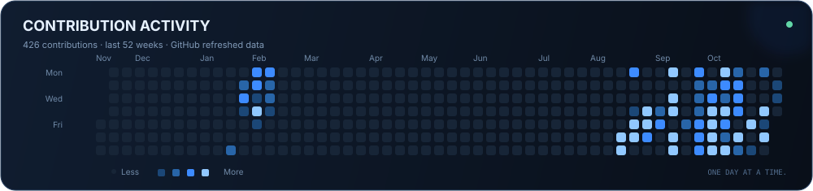

  <strong>Full-stack developer · UI tinkerer · Linux enthusiast</strong>

  I build useful things, obsess over the details, and occasionally argue with CSS.

  

## `about.md`

I'm **Abdellah Mouida**, a developer who enjoys building thoughtful digital products — from full-stack web apps and Android experiments to Python tools and motion-rich interfaces. I care about clean engineering, useful details, and experiences that feel good to use.

**Into:** polished UI/UX · full-stack engineering · open source · Linux · 3D and motion.

  

  

## `currently-building`

<table>
  <tr>
    <td width="50%" valign="top">
      <h3>🔷 Ihyaa · Community Platform</h3>
      A bilingual platform for the <a href="https://github.com/Ihyaa-Program">Ihyaa Program</a> community.
        
      Arabic / English · RTL / LTR · events · member and admin tools
        
      <a href="https://github.com/Abdellah-mouida/Ihya-iacsas">View repository</a> · <a href="https://ihyaa.is-cool.dev">Visit platform</a>
    </td>
    <td width="50%" valign="top">
      <h3>🌌 Personal Portfolio</h3>
      A visual portfolio exploring 3D scenes, expressive interaction, and motion.
        
      React · TypeScript · three.js · GLSL
        
      <a href="https://github.com/Abdellah-mouida/zx">View project</a>
    </td>
  </tr>
  <tr>
    <td width="50%" valign="top">
      <h3>🎧 XMusic · Terminal Audio</h3>
      A lightweight terminal music player with a custom animated interface.
        
      Python · miniaudio · Mutagen
        
      <a href="https://github.com/Abdellah-mouida/XMusic">View repository</a>
    </td>
    <td width="50%" valign="top">
      <h3>📱 NewPipe · Android</h3>
      A NewPipe fork focused on modern navigation, rounded UI, and smoother motion.
        
      Java · Android
        
      <a href="https://github.com/Abdellah-mouida/NewPipe">View repository</a>
    </td>
  </tr>
</table>

  

## `toolbox` / technologies I use and explore

| Area | Technologies |
|:--|:--|
| **Web** | React, Next.js, TypeScript, Tailwind CSS, Node.js |
| **Backend & quality** | Prisma, PostgreSQL, Playwright, Git, Vercel |
| **3D & motion** | three.js, React Three Fiber, GSAP, GLSL |
| **Environment** | Ubuntu, Linux, Zsh, Python, Java, OpenCode, LiteLLM |

  

## `selected-work`

| Project | Focus |
|:--|:--|
| [**Ihya-iacsas**](https://github.com/Abdellah-mouida/Ihya-iacsas) | Bilingual community platform · Next.js |
| [**zx**](https://github.com/Abdellah-mouida/zx) | Personal portfolio · 3D and motion |
| [**XMusic**](https://github.com/Abdellah-mouida/XMusic) | Animated Python terminal music player |
| [**NewPipe**](https://github.com/Abdellah-mouida/NewPipe) | Android fork · UI redesign |

  

  

## `github-dashboard` / live profile snapshots

Live GitHub snapshots, generated and hosted right here.

  

  

  

### The contribution snake 🐍

  

  

## `developer.log`

- “Works on my machine.” — then ship the machine.
- CSS is just a negotiation between `z-index` values.

  <strong>Currently:</strong> building · debugging · refilling coffee

  

**Thanks for stopping by. Have a good one, and may your builds stay green.** 💙

<a href="https://github.com/Abdellah-mouida">GitHub</a> ·
<a href="https://github.com/Ihyaa-Program">Ihyaa Program</a> ·
<a href="https://ihyaa.is-cool.dev">Ihyaa Platform</a>

Built with curiosity, coffee, and a suspicious number of browser tabs.

