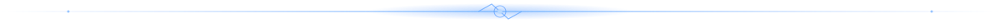

 

  

## `whoami`  /  the person behind the commits

~~~text
╭──────────────────────────────────────────────────────────────────────╮
│                                                                      │
│   Z E R O O X        THINK IN SYSTEMS  ·  BUILD WITH INTENT          │
│                                                                      │
│   ┌──(abdellah@zeroox)-[~/workspace]                                 │
│   └─$ whoami                                                         │
│      Abdellah Mouida                                                 │
│                                                                      │
│   └─$ cat /etc/profile                                               │
│      role       : developer & independent builder                    │
│      focus      : full-stack web · UI engineering · Linux            │
│      interests  : 3D visuals · motion · open source · automation     │
│      languages  : Arabic / English · RTL / LTR interfaces            │
│      philosophy : break it → understand it → build it better         │
│                                                                      │
│   └─$ _                                                              │
╰──────────────────────────────────────────────────────────────────────╯
~~~

I'm **Abdellah Mouida**, the developer behind **Zeroox**. I enjoy turning rough ideas into thoughtful digital products — from full-stack platforms and Android experiments to terminal tools and motion-rich interfaces.

I care about the whole experience: how a product works, how it feels, how it adapts to different screens and languages, and how maintainable it is underneath. I like exploring the boundary between engineering and visual design, without forgetting the fundamentals.

  

## `current mission`  /  what I'm building

<table>
  <tr>
    <td width="50%" valign="top">
      <h3>🔷 Ihyaa · Community Platform</h3>
      A bilingual platform for the <a href="https://github.com/Ihyaa-Program">Ihyaa Program</a> community, designed around useful member experiences and community workflows.
        
      <strong>Focus</strong> 
      Arabic / English · RTL / LTR · events · authentication · role-based admin tools
        
      <a href="https://github.com/Abdellah-mouida/Ihya-iacsas">Source code</a> · <a href="https://ihyaa.is-cool.dev">Live platform</a>
    </td>
    <td width="50%" valign="top">
      <h3>⚡ ZEROOX · Personal Identity</h3>
      A motion-first portfolio experiment exploring a distinctive developer identity through deep-black surfaces, electric blue, 3D scenes and atmospheric visuals.
        
      <strong>Exploring</strong> 
      React · TypeScript · three.js · GLSL · scroll-driven motion · visual systems
        
      <a href="https://github.com/Abdellah-mouida/zx">Explore the project</a>
    </td>
  </tr>
  <tr>
    <td width="50%" valign="top">
      <h3>🎧 XMusic · Terminal Audio</h3>
      A lightweight, animated terminal music player for local audio, with keyboard and mouse controls and an electric-blue terminal interface.
        
      <strong>Built with</strong> 
      Python · miniaudio · Mutagen · terminal UI
        
      <a href="https://github.com/Abdellah-mouida/XMusic">Explore XMusic</a>
    </td>
    <td width="50%" valign="top">
      <h3>📱 NewPipe · Android</h3>
      Working on a NewPipe fork with a stronger focus on modern Android UI, smoother navigation, rounded components and meaningful motion.
        
      <strong>Exploring</strong> 
      Java · Android · UI refinement · interaction design
        
      <a href="https://github.com/Abdellah-mouida/NewPipe">Explore the fork</a>
    </td>
  </tr>
</table>

  

## `the blueprint`  /  how I think

I like projects where the interface and the underlying system are designed together.

~~~text
       ┌─────────────────┐
       │   THE EXPERIENCE│
       │  clear · fast · human
       └────────┬────────┘
                │
                ▼
       ┌─────────────────┐
       │   THE ENGINE    │
       │  logic · APIs · data
       └────────┬────────┘
                │
                ▼
       ┌─────────────────┐
       │   THE FOUNDATION│
       │  quality · security
       │  maintainability
       └─────────────────┘

       BREAK IT
          ↓
     UNDERSTAND IT
          ↓
      BUILD BETTER
          ↺
~~~

**My rule:** don't stop at making something work. Understand why it works, find where it can fail, and make the next iteration better.

  

## `toolkit`  /  technologies I work with

| Area | Tools and technologies |
|:--|:--|
| **Frontend** | React, Next.js, TypeScript, JavaScript, Tailwind CSS, HTML, CSS |
| **Backend & data** | Node.js, Prisma, PostgreSQL, Neon, server-side application logic |
| **Motion & 3D** | three.js, React Three Fiber, GSAP, Framer Motion, GLSL |
| **Android & desktop** | Java, Android projects, Python terminal applications |
| **Testing & delivery** | Playwright, Git, GitHub, Vercel |
| **Environment & workflow** | Ubuntu, Linux, Zsh, OpenCode, LiteLLM, AI-assisted development |

  

## `selected repositories`  /  things I've shipped and explored

| Project | Description | Stack |
|:--|:--|:--|
| [**Ihya-iacsas**](https://github.com/Abdellah-mouida/Ihya-iacsas) | Bilingual community platform for Ihyaa Program | TypeScript · Next.js |
| [**zx**](https://github.com/Abdellah-mouida/zx) | ZEROOX portfolio and visual identity experiments | TypeScript |
| [**XMusic**](https://github.com/Abdellah-mouida/XMusic) | Animated terminal music player for local audio | Python |
| [**NewPipe**](https://github.com/Abdellah-mouida/NewPipe) | NewPipe Android fork and UI redesign work | Java |
| [**Hiworld client**](https://github.com/Abdellah-mouida/Hiworld-v1-client) | Front end for a social platform to publish and review posts | CSS · React |
| [**Hiworld server**](https://github.com/Abdellah-mouida/Hiworld-v1-server) | Back-end companion for Hiworld | JavaScript |

  

  

## `github telemetry`  /  activity at a glance

  

  

### Contribution snake

The snake animation is generated automatically by the repository workflow and published to the <code>output</code> branch.

  

  

## `transmit`  /  find me around the web

  

**Open to interesting ideas, thoughtful collaboration, and useful open-source work.**

Made with curiosity, a terminal, and too many iterations. · Zeroox © 2026

  

